# KYRA AI Guardrail Free: 사용 가이드

[English](guide.md)

- **본 문서의 범위**: 확장 프로그램 설치, 설정, 사용자 화면, 관리 서버(선택) 운영
- **화면 자료**: 시연용 대화 페이지와 예시 주소 사용, 실제 AI 서비스 화면 미포함

## 목차

1. [개요](#1-개요)
2. [설치](#2-설치)
3. [AI 서비스 설정: 허용, 경고, 차단](#3-ai-서비스-설정-허용-경고-차단)
4. [검사 설정 및 데이터 규칙](#4-검사-설정-및-데이터-규칙)
5. [사용자 화면](#5-사용자-화면)
6. [활동 기록 및 팝업](#6-활동-기록-및-팝업)
7. [언어](#7-언어)
8. [설정 공유 및 조직 배포](#8-설정-공유-및-조직-배포)
9. [관리 서버](#9-관리-서버)
10. [추가적으로 확인해야 되는 부분](#10-추가적으로-확인해야-되는-부분)
11. [상용 버전 및 문의처](#11-상용-버전-및-문의처)

## 1. 개요

| 구분 | 내용 |
|---|---|
| AI 서비스 | 기본 등록 65개 서비스별 허용, 경고, 차단 지정. 직접 추가 가능 |
| 메시지 | AI 사이트에서 전송 전에 데이터 규칙으로 검사 |
| 파일 | 첨부한 텍스트, Word, Excel, PowerPoint 파일의 텍스트를 동일 방식으로 검사 |
| 데이터 규칙 | 기본 규칙 16개 및 사용자 규칙(키워드, 정규식) |
| 활동 기록 | 최근 500건을 브라우저에 보관. 사이트와 규칙만 기록, 입력 내용 미기록 |
| 관리 서버 | 선택 사항. 조직이 자체 운영하는 서버에서 브라우저가 설정을 내려받고, 서버는 연결된 브라우저 목록 표시 |

- **처리 위치**: 모든 검사는 브라우저 내부에서 수행
- **외부 전송**: 입력 내용의 외부 전송 없음
- **네트워크 요청**: 기본 상태에서 없음. 관리 서버 연결 시 설정 내려받기 및 상태 보고(이름, 버전, 일별 건수) 발생

## 2. 설치

- **빌드 절차**: 없음

1. `chrome://extensions`(또는 `edge://extensions`) 접속 후 **개발자 모드** 사용 설정
2. 압축 해제된 확장 프로그램 로드 버튼 선택 후 `extension/` 폴더 지정
3. 설정 화면 자동 표시. 최초 상태는 기본 등록 서비스 전체 허용 및 전송 내용 검사

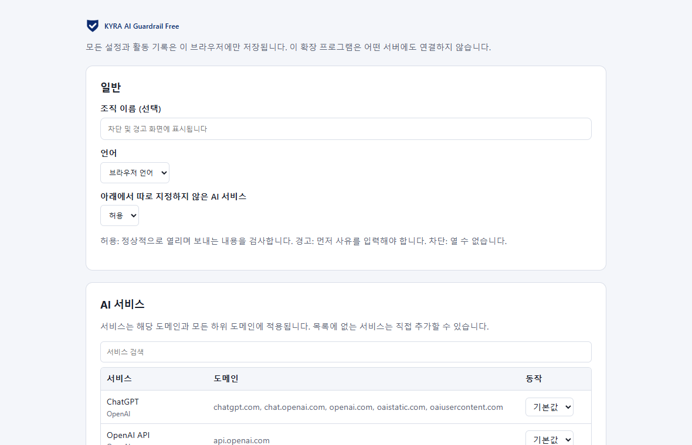

- **설정 화면 재진입**: 확장 프로그램 아이콘 선택 후 **설정**

## 3. AI 서비스 설정: 허용, 경고, 차단

- **일반**: 경고 및 차단 화면에 표시할 조직 이름, 별도 지정이 없는 기본 등록 서비스의 처리 방식 지정

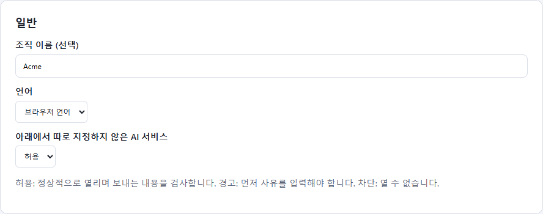

- **AI 서비스**: 서비스별 도메인과 처리 방식 표시. 서비스는 해당 도메인과 모든 하위 도메인에 적용

| 처리 방식 | 동작 |
|---|---|
| 허용 | 사이트 정상 접속, 전송 내용 검사 |
| 경고 | 경고 화면에서 사유 입력 요구. 사유 입력 시 1시간 동안 접속 허용 |
| 차단 | 사이트 접속 불가 |

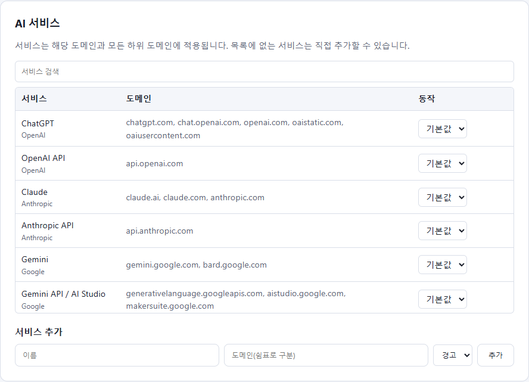

- **서비스 추가**: **서비스 추가**에 이름과 도메인 입력. 브라우저가 해당 사이트 접근 허용 여부 확인
- **접근 미허용 상태**: "사이트 접근 필요" 표시 및 미적용. **접근 허용** 선택으로 해소

## 4. 검사 설정 및 데이터 규칙

- **AI 사이트 검사**: 메시지 검사 및 첨부 파일 검사 사용 여부, 읽을 수 없는 파일(이미지, PDF, 압축 파일)의 처리 방식 지정

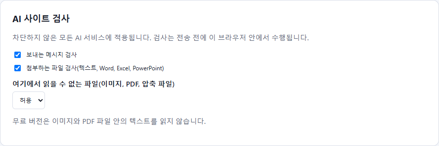

- **데이터 규칙**: 기본 규칙별 사용 안 함, 경고, 차단 지정

| 규칙 | 기본값 |
|---|---|
| 주민등록번호, 외국인등록번호 | 차단 |
| 여권번호, 운전면허번호, 휴대전화번호 | 경고 |
| 보안 등급 표시(대외비, Ⅰ·Ⅱ·Ⅲ급 비밀, 군사기밀) | 경고 |
| 카드번호 | 차단 |
| 개인 키, AWS 액세스 키, API 키 또는 토큰 | 차단 |
| JWT 토큰, 비밀번호 기재 | 경고 |
| 이메일 주소, 사업자등록번호, 법인등록번호, 유선전화번호 | 사용 안 함 |

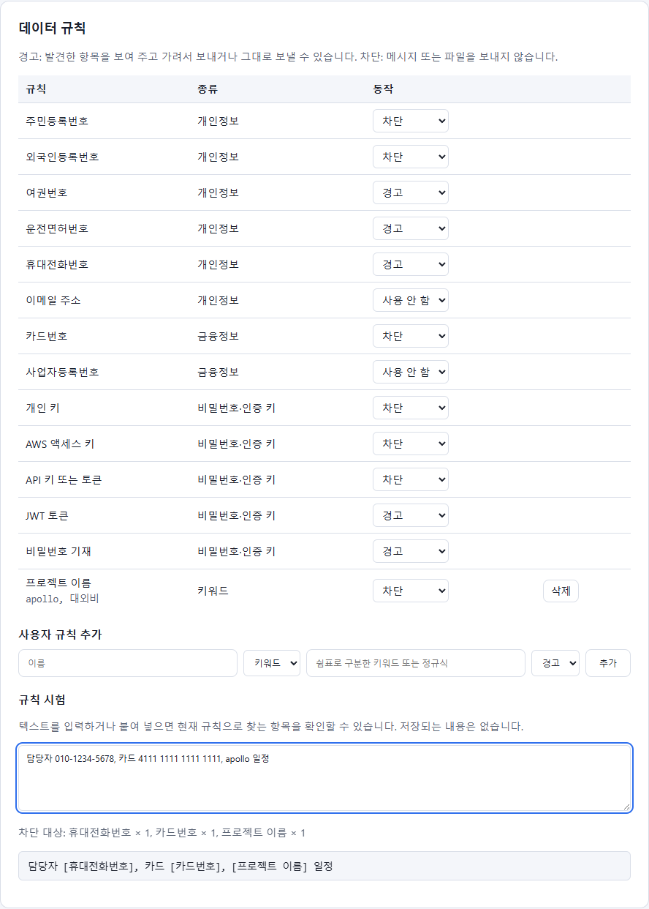

- **사용자 규칙 추가**: 키워드(쉼표 구분) 또는 정규식, 경고 또는 차단 지정. 검사를 지연시키는 정규식은 등록 거부
- **규칙 시험**: 텍스트 입력 시 현재 규칙의 탐지 항목과 마스킹 결과 표시. 입력 내용 미저장

## 5. 사용자 화면

- **경고**: 메시지 전송 보류 및 탐지 항목 표시. 메시지 수정, 마스킹 후 전송, 그대로 전송 중 선택

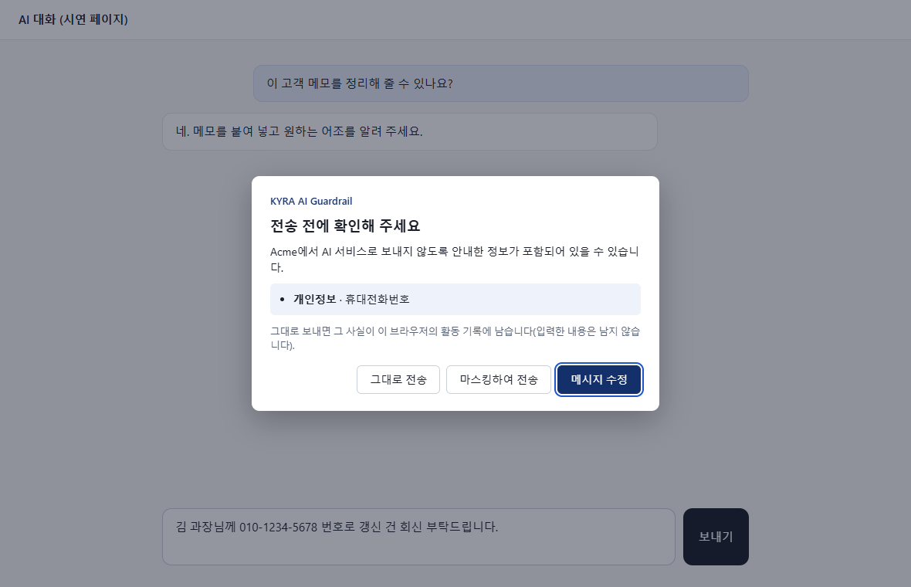

- **메시지 차단**: 차단 규칙에 해당하는 항목은 전송 불가

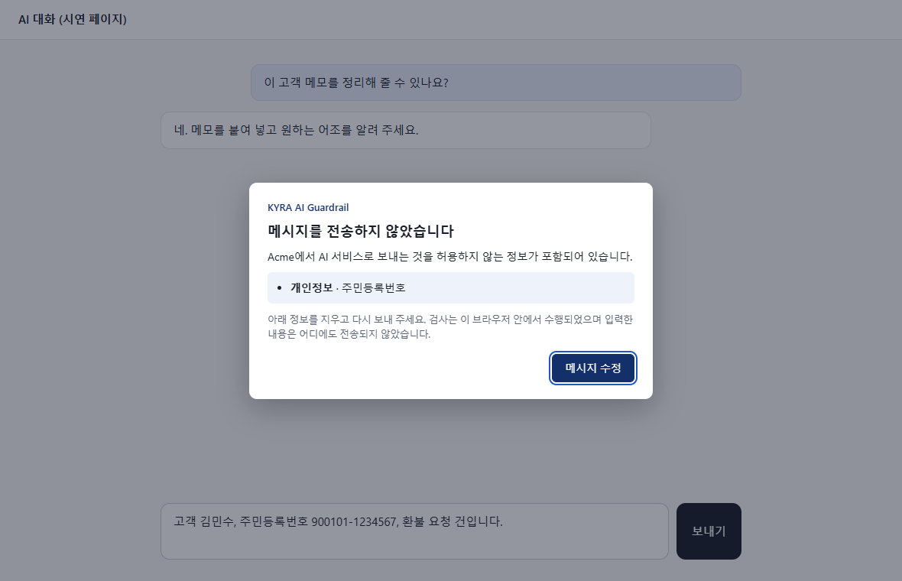

- **파일**: 첨부 파일의 텍스트를 사이트 전달 전에 검사

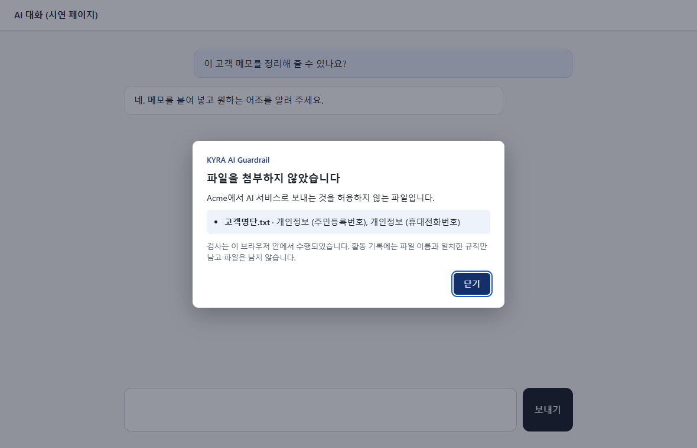

- **차단 서비스**

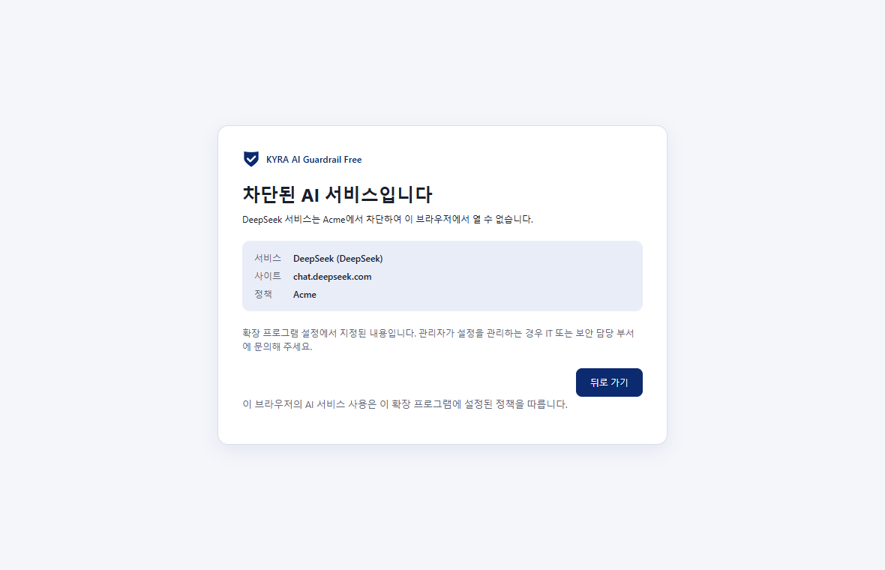

- **경고 서비스**: 사유 입력 후 1시간 동안 접속 허용

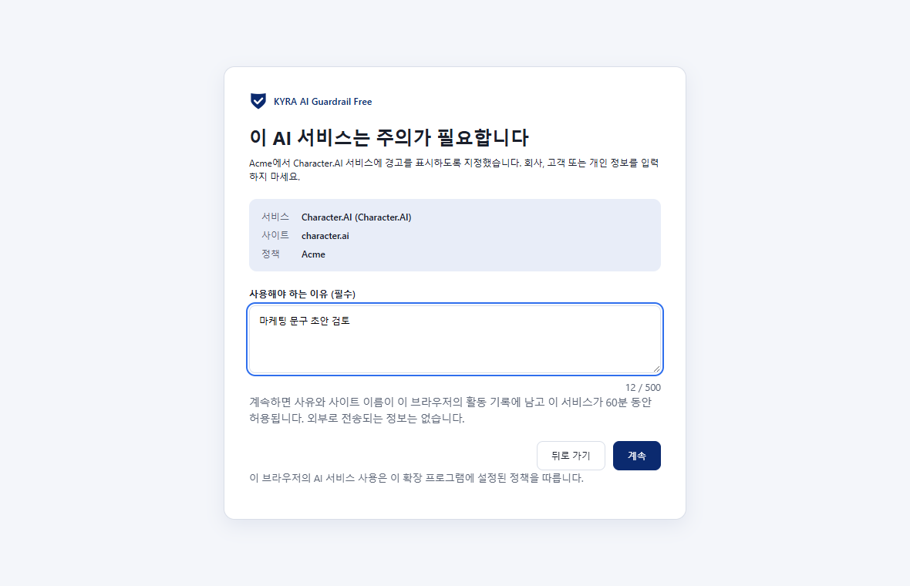

## 6. 활동 기록 및 팝업

- **보관 범위**: 최근 500건, 해당 브라우저 내부
- **기록 항목**: 시각, 이벤트, 서비스, 규칙 이름 또는 파일 이름. 메시지 본문과 파일 내용 미기록
- **기능**: CSV 저장, 기록 삭제, 기록 사용 중지

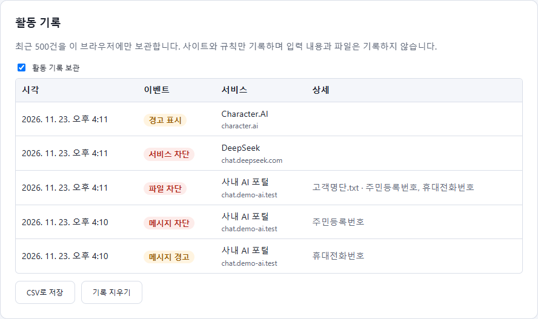

- **팝업**: 확장 프로그램 아이콘 선택 시 서비스 수, 적용 중인 검사, 최근 24시간 건수 표시

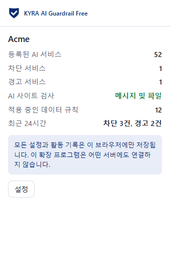

## 7. 언어

- **설정 위치**: 일반 설정의 **언어**
- **브라우저 언어(기본값)**: 한국어 브라우저에서는 한국어, 그 외 영어
- **English 또는 한국어**: 브라우저 언어와 무관하게 설정 화면, 팝업, 경고 및 차단 화면, AI 사이트의 안내에 적용
- **조직 배포**: 언어 선택은 설정 문서에 포함되므로 관리자가 전체 사용자에게 동일하게 지정 가능

## 8. 설정 공유 및 조직 배포

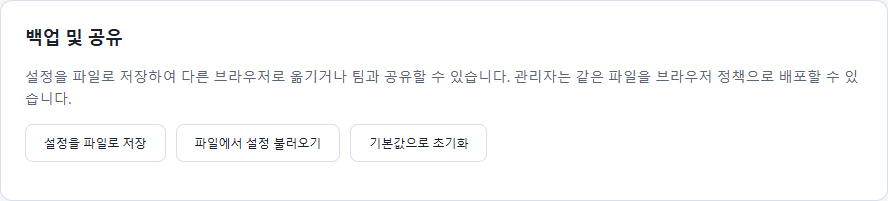

| 방식 | 방법 | 사용자 변경 가능 여부 |
|---|---|---|
| 파일 | **설정을 파일로 저장** 후 각 브라우저에서 **파일에서 설정 불러오기** | 가능 |
| 브라우저 정책 | 동일 문서를 `settingsJson` 정책 값으로 배포 | 불가 |
| 관리 서버 | 브라우저가 조직 서버에서 설정 내려받기(다음 장) | 연결 중 불가 |

- **브라우저 정책 예시(Windows, Chrome)**

```
HKLM\Software\Policies\Google\Chrome\ExtensionInstallForcelist
  1 (REG_SZ) = kidphjodkengcdmmpfdagohlnimmfmhb;https://clients2.google.com/service/update2/crx

HKLM\Software\Policies\Google\Chrome\3rdparty\extensions\kidphjodkengcdmmpfdagohlnimmfmhb\policy
  settingsJson (REG_SZ) = {"organisation":"Acme","services":{"deepseek":"block"}}
  serverUrl    (REG_SZ) = https://guardrail.example.com/
  serverKey    (REG_SZ) = <등록 키>
```

- **강제 설치**: 첫 번째 키로 Chrome 웹 스토어에서 설치하며 사용자의 제거 불가. `kidphjodkengcdmmpfdagohlnimmfmhb`는 스토어 ID
- **설정 배포 방식**: `settingsJson` 또는 `serverUrl`·`serverKey` 중 하나만 배포. 동시 배포 시 `settingsJson` 우선
- **기타 환경**: Microsoft Edge는 `HKLM\Software\Policies\Microsoft\Edge\...`에 동일 값 지정. macOS, Linux, Google 관리 콘솔, Intune은 동일 이름의 관리 환경설정 또는 구성 프로필로 지정

## 9. 관리 서버

- **정의**: 조직이 자체 운영하는 소규모 프로그램. 설정 문서 1건을 보관하여 연결된 모든 브라우저에 배포하고, 연결된 브라우저의 버전과 일별 건수를 목록으로 표시
- **수신 정보**: 사이트, 규칙, 파일 이름, 입력 내용 미수신

### 서버 실행

- **요구 사항**: Node 20 이상, 추가 설치 항목 없음

```
node server/server.js
```

| 설정 | 기본값 | 의미 |
|---|---|---|
| `PORT` | `8787` | 수신 포트 |
| `HOST` | `127.0.0.1` | 수신 주소. 다른 장비에서 접근하려면 지정 필요 |
| `KYRA_DATA_DIR` | `./data` | 서버가 보관하는 유일한 파일 `state.json`의 폴더 |

- **관리자 키**: 최초 실행 시 1회 표시. 안전한 곳에 보관 필요
- **관리자 키 재발급**: `node server/server.js --reset-admin-key`
- **HTTPS 적용**: 시험 용도 외에는 인증서를 적용한 리버스 프록시 뒤에 배치 필요. 다른 PC의 HTTP 주소는 확장 프로그램이 연결 거부(설정과 등록 키의 네트워크 노출·변조 방지). 동일 PC의 HTTP 주소는 시험용으로 허용

### 설정 등록

1. 브라우저에서 서버 주소 접속 후 관리자 키로 로그인

   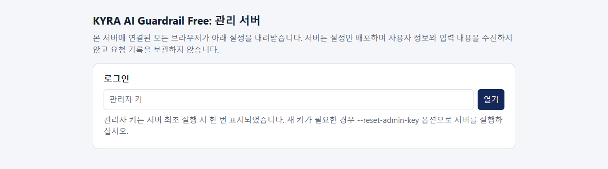

2. 확장 프로그램이 설치된 브라우저에서 설정 구성 후 **설정을 파일로 저장**
3. 관리 화면에서 **설정 파일 불러오기**로 해당 파일 선택 후 **저장 및 배포**. 화면에서 문서 직접 수정 가능

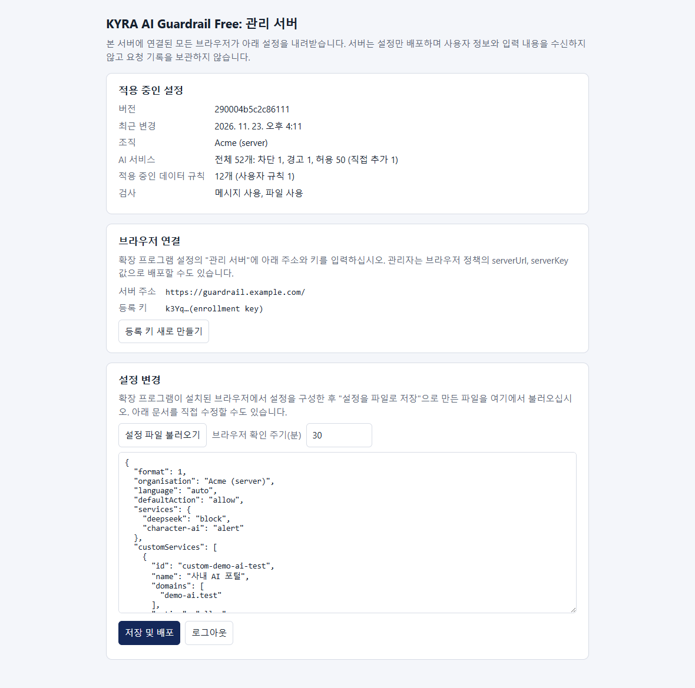

- **표시 항목**: 적용 중인 설정, 브라우저 연결에 필요한 **서버 주소**와 **등록 키**, 브라우저 확인 주기(5분 이상 1일 이하, 기본 30분)
- **등록 키 새로 만들기**: 기존 키를 보유한 브라우저의 내려받기 중단. 새 키 입력 전까지 보유 중인 설정 유지

- **연결된 브라우저**: 브라우저별 최근 보고 내용 표시. 이름, 확장 프로그램 버전, 현재 설정 적용 여부, 검사 사용 여부, 최근 접속 시각, 최근 7일 건수
- **미접속 표시**: 7일간 보고가 없는 브라우저에 표시
- **삭제**: 목록에서 브라우저 제거(예: 사용 종료 PC)

### 브라우저 연결

- **절차**: 확장 프로그램 설정의 **관리 서버**에 서버 주소, 등록 키, 브라우저 이름(선택) 입력 후 **연결**
- **브라우저 이름**: 관리 화면 목록에 표시되는 이름

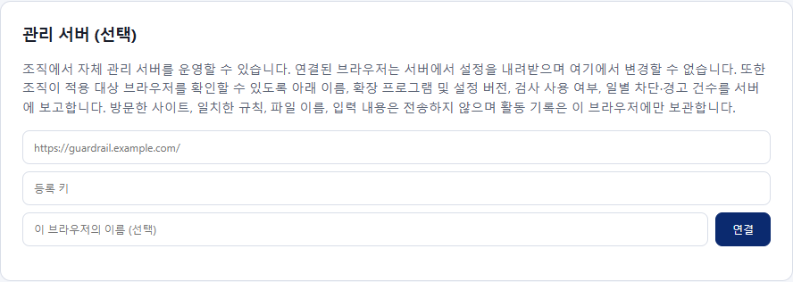

- **연결 후 상태**: 서버의 설정 적용, 설정 화면 읽기 전용

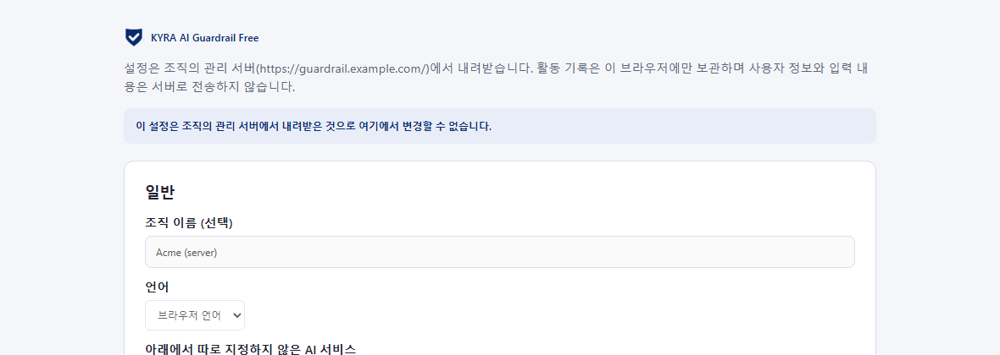

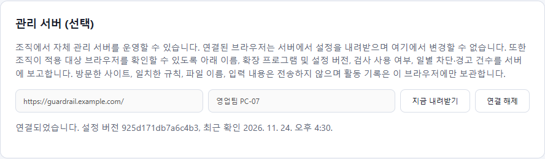

- **지금 내려받기**: 다음 확인 주기를 기다리지 않고 즉시 내려받기
- **연결 해제**: 해당 브라우저의 자체 설정으로 복귀
- **정책 배포**: 브라우저 관리 환경에서는 `serverUrl`, `serverKey` 정책 값으로 배포하고 이름은 `deviceLabel`로 지정. 이 경우 사용자의 연결 해제 불가
- **HTTP 주소 거부**: 다른 장비의 HTTP 서버 주소는 연결 거부(설정과 등록 키의 네트워크 노출·변조 방지)

### 연결된 브라우저의 동작

| 상황 | 동작 |
|---|---|
| 정상 | 브라우저 시작 시 및 관리 화면에서 지정한 주기마다 설정 내려받기 |
| 서버 접속 불가 | 마지막으로 내려받은 설정 유지 |
| 등록 키 불일치 | 변경 없음. 설정 화면에 키 미승인 안내 표시 |
| `settingsJson` 정책 동시 배포 | 정책 설정이 서버 설정보다 우선 |
| 서버 설정에 직접 추가 서비스 포함 | 브라우저별로 **접근 허용** 1회 필요 |

### 연결된 브라우저의 보고 내용

| 보고 항목 | 보고하지 않는 항목 |
|---|---|
| 브라우저 이름(선택), 임의 생성 브라우저 ID 및 비밀 값 | 방문하거나 사용한 사이트 |
| 확장 프로그램 버전 및 적용 중인 설정 버전 | 일치한 규칙 |
| 메시지 검사 및 파일 검사 사용 여부 | 파일 이름 |
| 사이트 접근 대기 중인 직접 추가 서비스 수 | 경고 화면에 입력한 사유 |
| 최근 7일의 일별 건수: 차단, 경고, 경고 후 전송 | 입력하거나 첨부한 내용 |

- **건수 산출**: 브라우저의 활동 기록(최대 500건)에서 집계. 활동 기록 사용 중지 시 건수 미보고
- **서버 보관 범위**: 브라우저별 최근 보고 1건. 네트워크 주소 미보관
- **비밀 값 확인**: 서버는 비밀 값의 해시만 보관. 동일 ID의 이후 보고는 동일 비밀 값인 경우에만 반영

### 운영 시 고려 사항

- **HTTPS 적용**: 인증서를 보유한 리버스 프록시 뒤에 배치
- **경로 접두사**: `https://example.com/kyra/`와 같은 하위 경로 배치 가능. 관리 화면은 마지막 슬래시를 포함한 주소로 접속하고 브라우저에도 동일 주소 입력
- **관리자 키 오입력**: 동일 주소에서 10회 초과 시 응답 지연. 올바른 키는 차단 대상 아님
- **관리자 키 보호**: 다른 장비의 HTTP 주소로 연 관리 화면은 관리자 키 미전송. 서버가 외부 접속 주소로 실행되는 경우 시작 시 경고 표시
- **신규 브라우저 제한**: 시간당 최대 1,000대 등록. 거부된 브라우저는 다음 확인 시 재시도
- **설정 공개 범위**: 검사가 브라우저에서 수행되므로 연결된 모든 브라우저가 사용자 규칙을 포함한 전체 설정 수신. 규칙에 비밀 정보 기재 금지
- **백업**: 데이터 폴더의 `state.json` 백업 필요. 설정, 등록 키, 브라우저 목록 포함

## 10. 추가적으로 확인해야 되는 부분

| 항목 | 확인 필요 사항 |
|---|---|
| 이미지·PDF 파일 | 이미지·PDF, 압축 파일, 20MB 초과 파일, 텍스트 100만 자 초과 파일은 검사 대상 외. 읽을 수 없는 파일의 처리 방식(신규 설치 기본값: 경고)을 경고 또는 차단으로 지정할지 검토 |
| 적용 범위 | 해당 브라우저에 한정되므로 데스크톱 앱, 명령줄 도구, 다른 브라우저에 대한 대책 검토 |
| 제거 및 연결 해제 | 강제 설치와 정책 배포(`settingsJson` 또는 `serverUrl`)를 적용하지 않은 경우 사용자가 제거 또는 연결 해제 가능하므로 배포 방식 검토 |
| 활동 기록 수집 | 관리 서버는 브라우저별 일별 건수만 표시하고 활동 기록은 각 브라우저에 보관되므로 중앙 수집이 필요한 경우 별도 방안 검토 |
| 브라우저 목록 | 목록은 각 브라우저가 보고한 내용이며 이름은 입력값 그대로이므로 자산 목록과 대조 |
| 관리 서버 구성 | 전체 사용자 대상 단일 설정이며 사용자, 그룹, 변경 이력 기능이 없으므로 조직 요구 사항과 대조 |
| 사이트별 차이 | 전송 인식은 Enter 키와 전송 버튼 기준이므로 사용 중인 AI 사이트에서 동작 확인 |
| 우회 입력 | 검사 전 기본 정규화(보이지 않는 문자, 전각 숫자, 글자 사이 공백) 적용. 그 밖의 방식으로 변형한 값의 통과 가능성 검토 |
| 설정 공개 범위 | 연결된 모든 브라우저가 사용자 규칙을 포함한 전체 설정을 수신하므로 규칙의 비밀 정보 포함 여부 확인 |

## 11. 상용 버전 및 문의처

- **제품**: (주)씨커스 KYRA AI Guardrail 상용 버전
- **추가 기능**: 중앙 정책 및 중앙 활동 기록·보고서, 사용자·그룹별 정책, 이미지·PDF 파일 텍스트 인식, 데이터 등급 제한, 변경 이력
- **구성**: 상용 버전 확장 프로그램은 별도 프로그램이며 본 무료 버전과 연동하지 않음

| 구분 | 연락처 |
|---|---|
| 제품 소개 | https://seekerslab.com/ko/ai/guardrail |
| 데모 신청 | https://seekerslab.com/ko/demo |
| 문의 | https://seekerslab.com/ko/company/contact |
| 이메일 | contact@seekerslab.com |
| 전화 | 02-2039-8160 |
