# KYRA AI Guardrail Free: user guide

[한국어](guide.ko.md)

This guide covers installing the extension, setting it up, what people see while they work, and
running the optional management server. The pictures use a stand-in chat page and example
addresses; no real AI service appears in them.

## Contents

1. [What it does](#1-what-it-does)
2. [Install](#2-install)
3. [AI services: allow, warn or block](#3-ai-services-allow-warn-or-block)
4. [Checks and data rules](#4-checks-and-data-rules)
5. [What people see](#5-what-people-see)
6. [Activity log and popup](#6-activity-log-and-popup)
7. [Language](#7-language)
8. [Share settings with a team](#8-share-settings-with-a-team)
9. [Management server](#9-management-server)
10. [What to check before relying on it](#10-what-to-check-before-relying-on-it)

## 1. What it does

| Area | What happens |
|---|---|
| AI services | 51 known services, each allowed, warned about or blocked. You can add your own. |
| Messages | A message is checked against the data rules before it is sent on an AI site. |
| Files | The text of attached text, Word, Excel and PowerPoint files is checked the same way. |
| Data rules | 13 built-in rules and your own keyword or regular-expression rules. |
| Activity log | The last 500 events, kept in the browser. Site and rule only, never the text. |
| Management server | Optional. A server your organization runs; browsers download settings from it. |

Everything is checked in the browser. Nothing about you or what you send goes anywhere. Out of
the box the extension makes no network request; with a management server it downloads settings
and still sends nothing.

## 2. Install

There is no build step.

1. Open `chrome://extensions` (or `edge://extensions`) and turn on **Developer mode**.
2. Choose **Load unpacked** and pick the `extension/` folder.
3. The settings page opens. A new install allows every known service and checks what is sent.

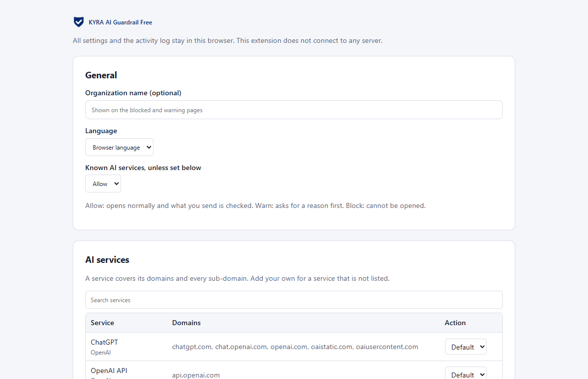

Open the settings again at any time from the extension icon, then **Settings**.

## 3. AI services: allow, warn or block

The **General** section sets the organization name shown on warning and blocked pages, and what
happens on known AI services that have no choice of their own.

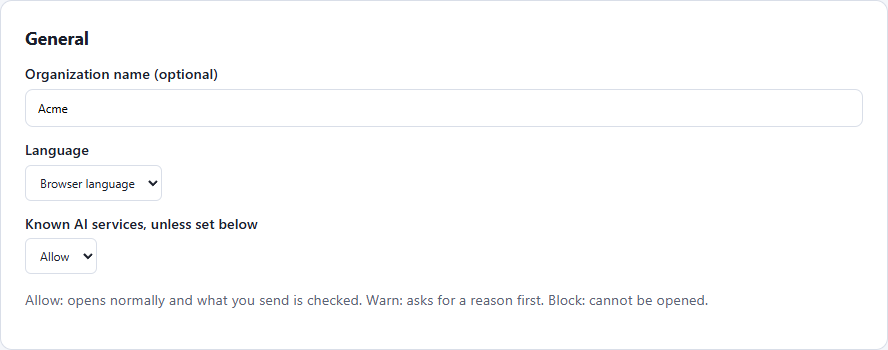

The **AI services** section lists every service with its domains. A service covers its domains
and every sub-domain.

| Action | Effect |
|---|---|
| Allow | The site opens normally, and what is sent to it is checked. |
| Warn | A warning page asks for a reason first. With a reason the site opens for one hour. |
| Block | The site cannot be opened. |

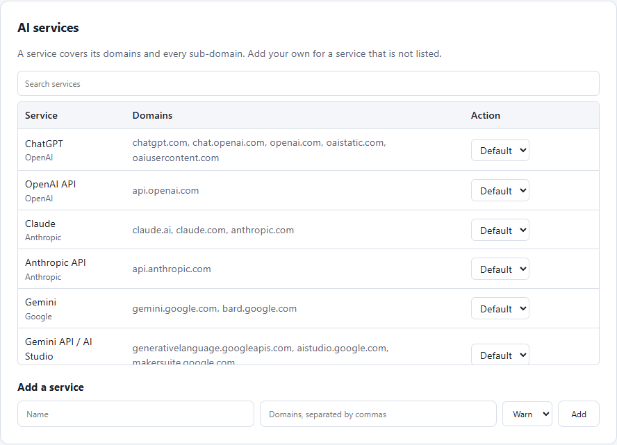

To add a service that is not listed, enter a name and its domains under **Add a service**. The
browser then asks for access to that site. Until access is given the service shows
"Needs site access" and is not enforced; press **Grant access** to give it.

## 4. Checks and data rules

The **Checks on AI sites** section turns the check of messages and of attached files on or off,
and sets what happens to files that cannot be read here (images, PDF, archives).

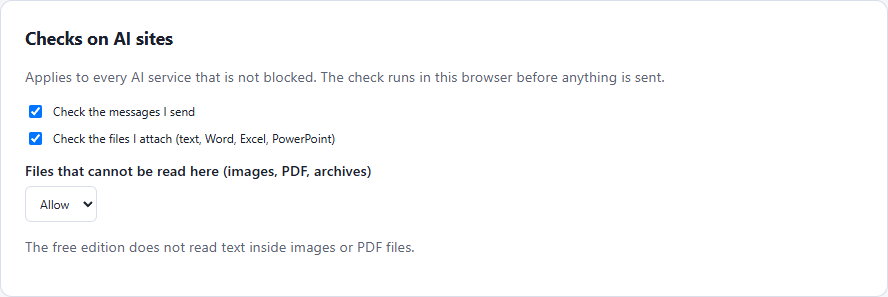

The **Data rules** section lists the built-in rules. Each can be off, warn or block.

| Rule | Default |
|---|---|
| Resident registration number (KR), foreigner registration number (KR) | Block |
| Passport number (KR), driver licence number (KR), mobile phone number (KR) | Warn |
| Payment card number | Block |
| Private key, AWS access key, API key or token | Block |
| JSON Web Token, password written out | Warn |
| E-mail address, business registration number (KR) | Off |

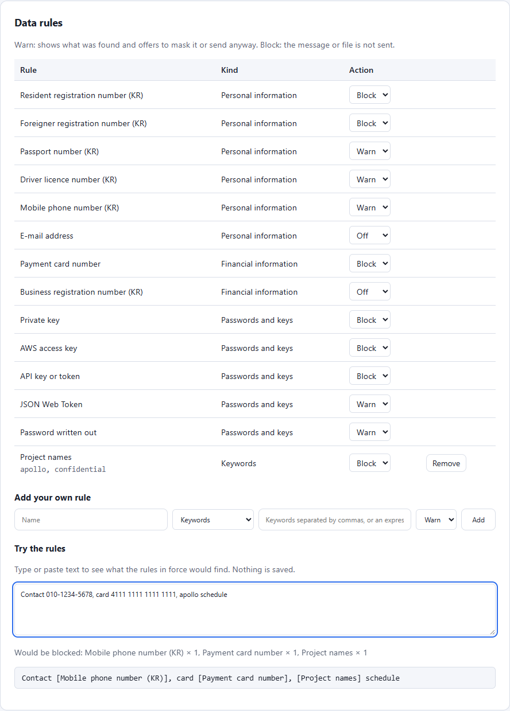

- **Add your own rule**: keywords (comma-separated) or a regular expression, set to warn or block.
  An expression slow enough to freeze the check is refused.
- **Try the rules**: type or paste text to see what the rules in force would find and how it
  would be masked. Nothing is saved.

## 5. What people see

**A warning.** The message is held and the finding is named. The person can edit the message,
send it with the finding masked, or send it anyway.

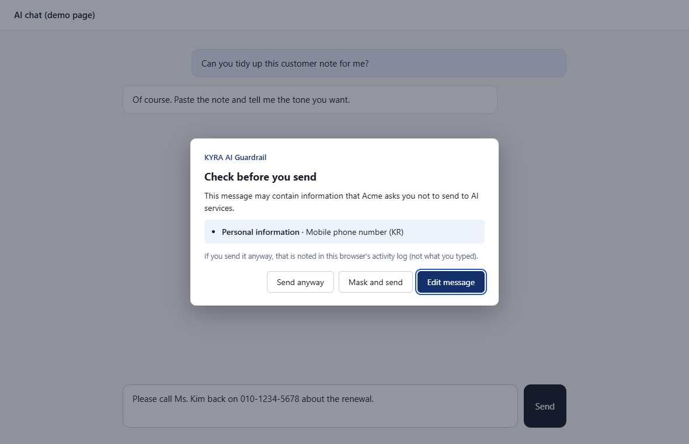

**A blocked message.** A finding from a rule set to block cannot be sent.

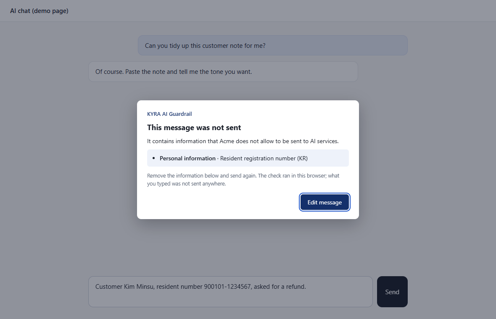

**A file.** The text of an attached file is checked before the site receives it.

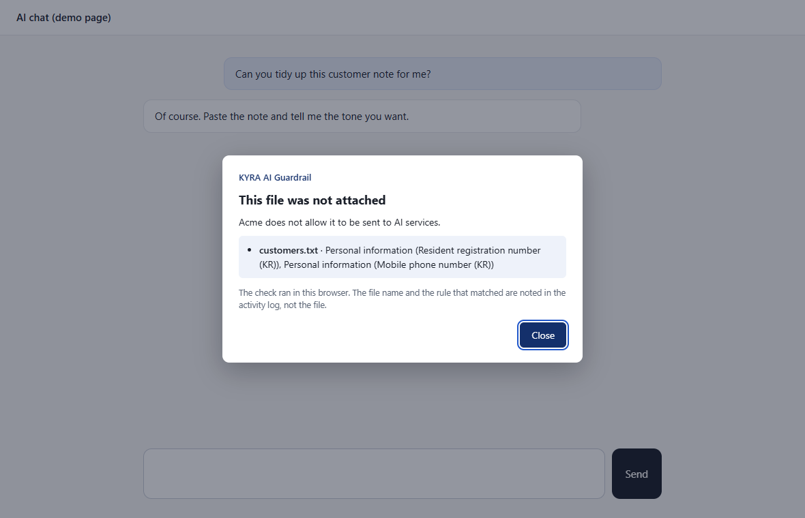

**A blocked service.**

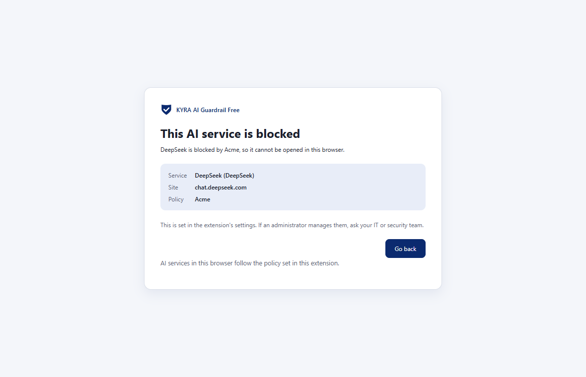

**A warned service.** A reason is needed to continue; the service then opens for one hour.

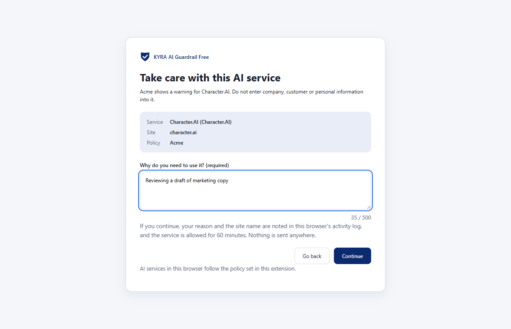

## 6. Activity log and popup

The log keeps the last 500 events in this browser: time, event, service, and the rule or file
name. It never holds the text of a message or the contents of a file. It can be saved as CSV,
cleared, or turned off.

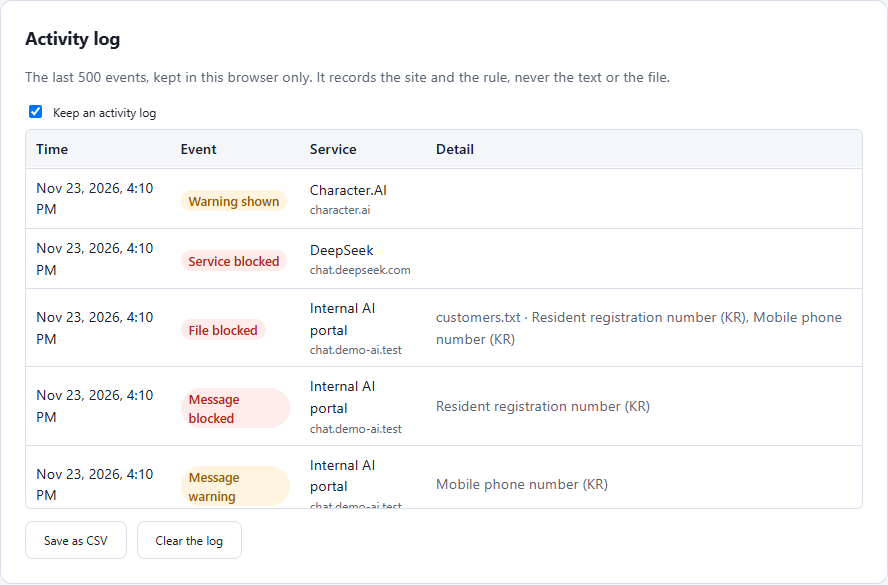

The popup behind the extension icon shows the number of services, the checks in force and the
last 24 hours.

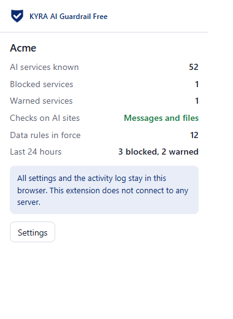

## 7. Language

**Language** in the General section is one of:

- **Browser language** (default): Korean on a Korean browser, English otherwise.
- **English** or **한국어**: used on the settings page, the popup, the warning and blocked
  pages, and the notices on AI sites, whatever the browser's language.

The choice is part of the settings, so an administrator can fix it for everyone.

## 8. Share settings with a team

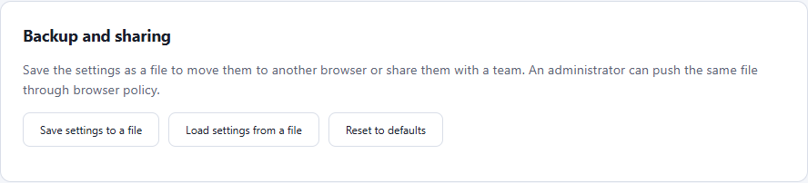

| Way | How | Can a person change it? |
|---|---|---|
| File | **Save settings to a file**, then **Load settings from a file** in each browser | Yes |
| Browser policy | Push the same document as the `settingsJson` policy value | No |
| Management server | Browsers download the settings from your server (next chapter) | No, while connected |

With browser policy on Windows, for Chrome:

```
HKLM\Software\Policies\Google\Chrome\3rdparty\extensions\<extension id>\policy
  settingsJson (REG_SZ) = {"organisation":"Acme","services":{"deepseek":"block"}}
```

## 9. Management server

The management server is a small program your organization runs itself. It holds one settings
document and hands it to every connected browser. It receives nothing about people or what they
send, and keeps no record of who asked.

### Start the server

It needs Node 20 or later and nothing else.

```
node server/server.js
```

| Setting | Default | Meaning |
|---|---|---|
| `PORT` | `8787` | Port to listen on |
| `HOST` | `127.0.0.1` | Address to listen on; set it to reach the server from other machines |
| `KYRA_DATA_DIR` | `./data` | Folder for `state.json`, the one file the server keeps |

The first start prints the **admin key** once. Keep it somewhere safe. To make a new one, run
`node server/server.js --reset-admin-key`.

Put the server behind HTTPS (a reverse proxy with a certificate) for anything beyond a trial.
Over plain HTTP the settings and the enrollment key can be read on the network.

### Set the settings

1. Open the server address in a browser and sign in with the admin key.

   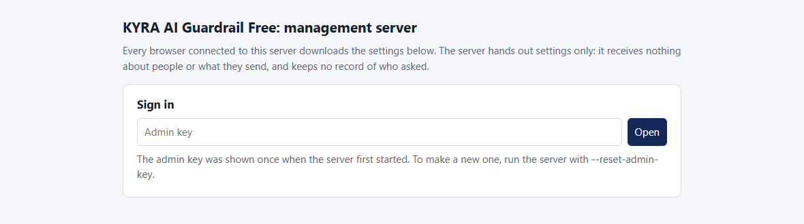

2. Set things up in your own browser with the extension and choose **Save settings to a file**.
3. On the admin page choose **Load a settings file**, pick that file, then **Save and hand out**.
   The document can also be edited on the page.

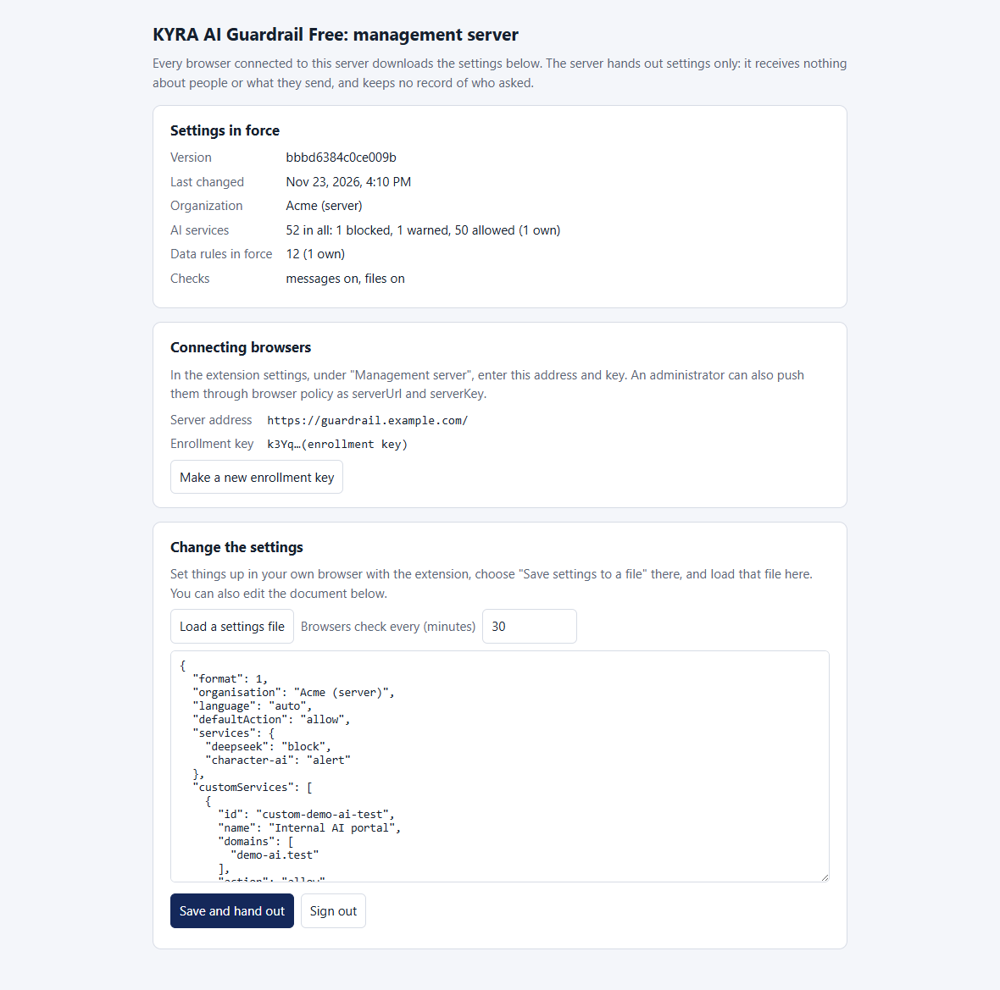

The page shows the settings in force, the **server address** and the **enrollment key** that
browsers need, and how often browsers check (5 minutes to one day, 30 minutes by default).
**Make a new enrollment key** stops browsers that hold the old key from downloading; they keep
the settings they have until they are given the new key.

### Connect a browser

In the extension settings, under **Management server**, enter the server address and the
enrollment key and press **Connect**.

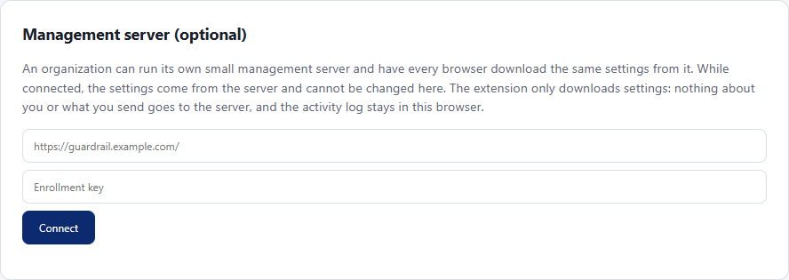

Once connected, the settings come from the server and the page is read-only.

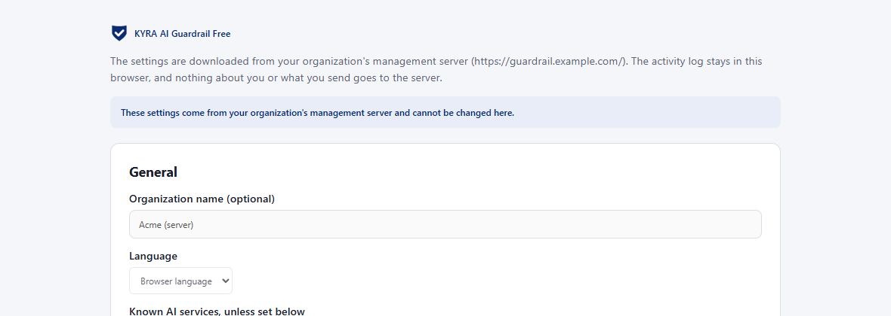

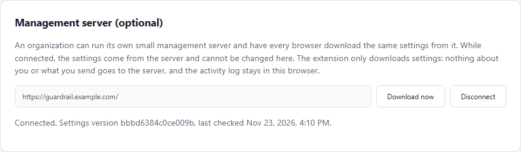

- **Download now** fetches the settings at once instead of waiting for the next check.
- **Disconnect** returns to this browser's own settings.
- With browser management, push the address and key as the `serverUrl` and `serverKey` policy
  values instead. A person then cannot disconnect.

### What a connected browser does

| Situation | Behaviour |
|---|---|
| Normal | Downloads the settings at start and then at the interval set on the admin page |
| Server cannot be reached | The settings downloaded last stay in force |
| Wrong enrollment key | Nothing changes; the page says the key was not accepted |
| `settingsJson` also pushed by policy | The policy settings win over the server |
| An own service in the server's settings | Needs **Grant access** once in each browser |

The request is a plain `GET` with the enrollment key. It carries no name, no browser id and no
activity.

## 10. What to check before relying on it

- **Images and PDF files are not read.** Choose what happens to files that cannot be read.
- **Only the browser is covered.** Desktop AI apps, command-line tools and other browsers are not.
- **A person can remove the extension or disconnect** unless an administrator force-installs it
  and pushes the settings or the server address through browser policy.
- **There is no central log.** The activity log stays in each browser, with or without the
  management server.
- **The management server is one set of settings for everyone.** It has no users, groups or
  change history.
- **Sites differ.** Sending is recognised by the Enter key and by send buttons. Check it on the
  AI sites you use.
